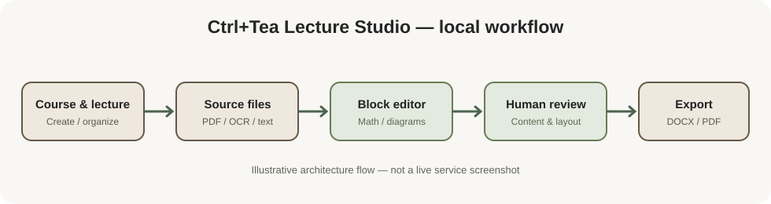

# Ctrl+Tea Lecture Studio

**An Arabic-first dashboard for preparing university lectures.**  
**Status:** Work in progress

I'm working on Ctrl+Tea Lecture Studio as part of **Ctrl+Tea**, a volunteer student team. We prepare and organize study materials for Computer Engineering students, and right now our team is focused on **third-year courses**.

We started building this dashboard because preparing a good lecture file involves more than writing text. We need to organize sources, review the content, work with equations and diagrams, and keep the final Word/PDF files consistent. The idea is to have that work in one place instead of managing it through separate files and tools.



## What the dashboard does

- Manage courses and lectures, including editing and restoring saved work.
- Work with structured lecture content: explanations, definitions, equations, examples, exercises, tables, and diagrams.
- Handle source material such as PDFs and transcripts, with OCR-related tools.
- Review and improve lecture content before exporting it.
- Export editable DOCX files and PDFs, including support for Word equations.
- Provide workspace and administration interfaces that we're still developing.

Some parts are already usable locally, while others still need testing and improvement. **This is a development version, not a public online service.**

## Tech stack

- **Frontend:** React, TypeScript, Vite
- **Backend:** Python, FastAPI
- **Storage:** SQLite for local use; PostgreSQL-related code for the multi-user work in progress
- **Documents:** LibreOffice, Pandoc, and OMML for Word equations
- **OCR:** Tesseract

## Public interactive preview

I added a small [browser-only demo](demo/) so visitors can explore the dashboard layout and try editing a sample lecture. It uses fictional content and keeps all changes inside the visitor's browser. There are no real accounts, student files, or connections to our backend.

The preview includes the course list, structured blocks, a simple editor, and a document preview. OCR, collaborative workflows, and server-side DOCX/PDF exports are **not** part of the public demo. See [demo setup](demo/README.md) for static hosting instructions.

## Try a sample lecture

I added a small example about binary numbers so the format can be explored without using a real student's lecture or private course files.

- [Example lecture (JSON)](examples/demo-lecture.json)
- [Demo import script](examples/seed_demo.py)

With the local development server running on port 8766:

```bash
python examples/seed_demo.py --url http://127.0.0.1:8766
```

If your server is running on port 8765, change the port in the command. The script is for a **local development instance only**; don't use it on a public server or with real student data.

## Run locally

You'll need Python 3.11+, Node.js, LibreOffice (including Math), Pandoc, and Tesseract with Arabic/English language data. See [README_AR.md](README_AR.md) for more details.

1. Install the backend dependencies:

```bash
python -m venv .venv
source .venv/bin/activate
pip install -e ".[postgres]" httpx
```

On Windows, activate the environment with `.venv\Scripts\activate`.

2. Build the frontend:

```bash
cd frontend
npm ci
npm run build
cd ..
```

3. Start a local instance:

```bash
export CTRLTEA_AUTH_MODE=local
export CTRLTEA_DB_BACKEND=sqlite
export CTRLTEA_DATA_DIR="$PWD/data"
python scripts/start.py --port 8765
```

Then open [http://127.0.0.1:8765](http://127.0.0.1:8765). These commands are for local development; **don't expose local mode to the internet**.

This repository doesn't include generated builds, private data, or bundled font files. You may need to install the fonts separately to match the team's document formatting. The PostgreSQL/multi-user setup also needs additional configuration and security work.

## What I'm improving next

- Making the editor and dashboard easier to use.
- Improving the lecture review process and scientific quality checks.
- Fixing export and formatting issues across different systems.
- Testing more real workflows and continuing work on multi-user access.

## Ctrl+Tea team

Ctrl+Tea is a volunteer student initiative. We're currently working on materials for **third-year Computer Engineering students**, and we plan to keep improving the content and the tools we use to prepare it.

**College Telegram bot:** [@CAE20_25_bot](https://t.me/CAE20_25_bot)

The college bot is one of our communication tools; it isn't integrated into Lecture Studio.

---

**بالعربي:** مشروع Ctrl+Tea Lecture Studio هو لوحة عمل لتجهيز المحاضرات وتنظيمها ومراجعتها وتصديرها. المشروع لسا قيد التطوير والتحسين، وفريق Ctrl+Tea حالياً مركز على مواد السنة الثالثة بهندسة الحواسيب. بوت الكلية: [@CAE20_25_bot](https://t.me/CAE20_25_bot).
